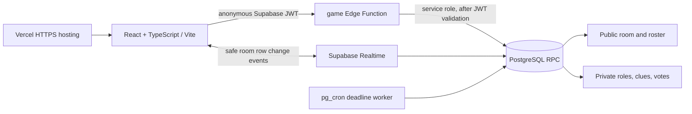

# Who Is the Impostor?

A real-time, guest-only social deduction game for 4–8 players. The React client talks only to the `game` Supabase Edge Function for game actions. PostgreSQL owns room membership, private roles, clues, votes, deadlines, phase transitions, and score settlement. Room row changes are published through Supabase Realtime; clients also poll the authenticated state endpoint so reconnects recover current state.

## Architecture

The browser receives only its own current-round role/word. Public room rows have no role or word fields. Direct table access is revoked from browser roles; RLS permits an authenticated room member to receive safe room row events only. Votes and role assignments are kept in separate RLS-protected tables. The Edge Function validates the Supabase guest JWT before invoking a `service_role`-only RPC. Round settlement is protected by a unique `(room_id, round)` result key and runs inside the same locked database transaction as score updates. Host starts/removals, joins, clues, and votes are checked and serialized in this RPC. The creator keeps ownership through a 120-second reconnect grace period; after that, the scheduled worker transfers ownership to the oldest recently active eligible member.

## Local setup

1. Create a Supabase project. Anonymous Sign-Ins are enabled in `supabase/config.toml`.
2. Install dependencies with `npm install`.
3. Copy `.env.example` to `.env.local` and set the project URL and anon key. These are public client values; never put a service-role key in a `VITE_*` variable.
4. Install the Supabase CLI and link the project: `supabase login`, then `supabase link --project-ref YOUR_REF`.
5. Apply project Auth settings, schema, and the function: `supabase config push`, `supabase db push`, then `supabase functions deploy game`.
6. Start the frontend with `npm run dev`.

The Supabase database migration enables `pg_cron` and schedules server phase processing every second. One-second schedules require Postgres 15.1.1.61 or later on Supabase. A state request also processes any deadline that has elapsed, so an active room catches up immediately on reconnect. On a project that does not support sub-minute cron intervals, enable `pg_cron` in Database > Extensions and change the schedule statement to `* * * * *` as a reduced-precision fallback. Expired rooms are cleaned up after 24 hours.

## Implementation plan

1. Create isolated room, member, private-role, clue, vote, and round-result tables with RLS and service-only action RPC.
2. Implement locked server actions for room membership, phase progression, result settlement, and scheduled deadline processing.
3. Build the responsive guest lobby and round screens, with Realtime updates plus persisted guest-session recovery.
4. Verify scoring and phase rules with Vitest, then exercise the responsive landing and lobby with Playwright before deployment.

## Commands

- `npm run dev` — local Vite server
- `npm run build` — TypeScript check and production bundle
- `npm test` — Vitest rule tests
- `npm run test:e2e` — Playwright browser checks (install a browser with `npx playwright install chromium` first)

Voice clues use browser `SpeechRecognition` or `webkitSpeechRecognition` when available. Microphone permission is requested by the browser after the player taps the mic; English is selected by default with Kannada available. Recognition stays browser-managed, and only reviewed clue text is sent to the game. Typed entry remains available everywhere.

## Deploy to Vercel

Import this repository into Vercel, select the Vite preset, and set `VITE_SUPABASE_URL` and `VITE_SUPABASE_ANON_KEY` in the project environment. Deploy the frontend with `vercel --prod`. Then deploy the Auth config, migration, and Edge Function to the linked Supabase project as above. Confirm that the Vercel URL loads over HTTPS and test room creation/joining from separate guest browser contexts.

## Verification and rollout status

- `npm test`: 7 Vitest tests passed.
- `npm run build`: TypeScript check and Vite production build passed.
- `npm run test:e2e`: 4 Playwright checks cover responsive layout, lobby rendering, invite URL copying, and mock speech transcript review.
- Production deployment: [https://who-is-the-impostor-taupe.vercel.app](https://who-is-the-impostor-taupe.vercel.app) returned HTTP 200 over HTTPS.
- Four independent browser sessions created and joined a production room, received private role reveals, submitted clues and votes, and completed three rounds. The database recorded three settled round results and a finished leaderboard.
- Supabase project `zbejlzoavvuskyrlykte` is active. Migrations through `host_kick_invites_fast_results` are applied, the `game` Edge Function is active with JWT verification, anonymous guest sign-in works, and the one-second deadline worker is scheduled. Performance advisor reports no findings; the security advisor reports the existing private tables with intentionally no client policies (direct table access is revoked) and configuration warnings.
- The requested `dkhosur.online/projects/whoisimposter` path is not routed yet. The apex currently resolves to two AWS IPv4 addresses and is not attached to the Vercel project; HTTPS checks to the current origin failed. The existing site host needs a path proxy/rewrite to this Vercel deployment, or the domain needs to be moved to a hosting setup that can serve the app at that path. Do not attach the apex to this Vercel project unless it is intended to replace the current whole-domain site.

## Rules and phase durations

Each match has three rounds. The host starts each round, and the server runs each phase through its deadline (clues and votes can finish early after everyone submits). The default role reveal, clue, discussion, voting, and results durations are 15, 60, 60, 30, and 15 seconds. Every round selects one impostor and a related word pair; detectives share the other word. Each player submits one clue and one private vote, with no self-votes. A tie produces no accusation and counts as impostor survival. Correct detective votes earn 2 points; an impostor who survives gains 2, and a correct impostor word guess gains 1. Guest sessions persist in the browser for reconnecting. A host may remove another player after confirmation; removed members are denied further room actions, and removal of the impostor settles that round. After 120 seconds without an update from the host, the scheduled worker atomically transfers ownership to the oldest active member seen in the last 30 seconds. Realtime broadcasts room changes, with a four-second authenticated state poll as a reconnect fallback.

